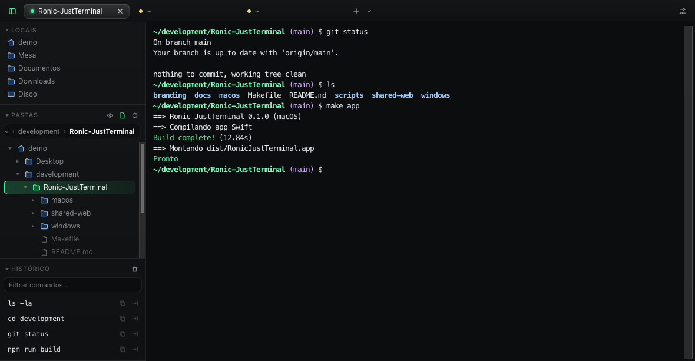

<p align="center">
  
</p>

<h1 align="center">Ronic JustTerminal</h1>

<p align="center">
  <b>Um terminal minimalista e rápido, com abas, pastas na lateral e histórico de comandos.</b><br>
  Visual de vidro com opacidade ajustável · continua rodando ao fechar a janela · macOS e Windows
</p>

<p align="center">
  <a href="https://github.com/jhowmael/Ronic-JustTerminal/releases/latest/download/RonicJustTerminal-macOS.zip">
    
  </a>
  &nbsp;
  <a href="https://github.com/jhowmael/Ronic-JustTerminal/releases/latest/download/RonicJustTerminal-Windows.zip">
    
  </a>
</p>

<p align="center">
  <a href="https://github.com/jhowmael/Ronic-JustTerminal/releases">Todas as versões</a> ·
  <a href="#instalação">Instalação</a> ·
  <a href="#atalhos">Atalhos</a> ·
  <a href="#rodar-e-testar-localmente">Rodar localmente</a> ·
  <a href="docs/BRIDGE.md">Arquitetura</a>
</p>

<p align="center">
  
</p>

---

## Downloads

| Sistema | Arquivo | Requisitos |
|---|---|---|
| **macOS** (Apple Silicon e Intel) | [`RonicJustTerminal-macOS.zip`](https://github.com/jhowmael/Ronic-JustTerminal/releases/latest/download/RonicJustTerminal-macOS.zip) | macOS 13 Ventura ou mais recente |
| **Windows** (64 bits) | [`RonicJustTerminal-Windows.zip`](https://github.com/jhowmael/Ronic-JustTerminal/releases/latest/download/RonicJustTerminal-Windows.zip) | Windows 10 (1809+) ou Windows 11 |

## O que ele faz

* **Abas independentes.** Cada aba tem a sua própria sessão de shell. Dá para abrir, alternar, renomear (duplo clique), reordenar (arrastar) e fechar. Uma bolinha amarela avisa quando há saída nova numa aba em segundo plano.
* **Pastas na lateral.** A árvore de pastas acompanha o terminal: um `cd development` atualiza a lateral na hora. Também funciona ao contrário: clique numa pasta (na árvore, no caminho ou em **Locais**) e o `cd` é digitado por você. Clique com o botão direito para abrir uma aba nova ali, copiar ou inserir o caminho, mostrar no Finder/Explorador ou fixar em Locais. Um duplo clique num arquivo insere o caminho dele no terminal.
* **Histórico de comandos.** Tudo que você digita aparece na lateral, com busca. Cada comando tem dois botões: **Copiar** e **Inserir no terminal** (sem executar, para você conferir antes do Enter).
* **Vidro com opacidade ajustável.** Ele já abre bem escuro (100% de opacidade). Diminua em **Ajustes** para o vidro aparecer (Liquid Glass no macOS 26, Acrylic no Windows 11). A escolha fica salva e volta igual na próxima vez que você abrir o app.
* **Continua rodando em segundo plano.** Fechar a janela **não** encerra os shells. No macOS, o ícone **R_** na barra de menus reabre a janela, abre uma aba nova ou encerra o app. No Windows, o ícone fica na bandeja do sistema, com as mesmas opções.
* **Rápido.** O xterm.js usa WebGL, a leitura do PTY roda em thread própria e há controle de fluxo: `cat` de um arquivo enorme não trava a janela. A interface não tem frameworks, só HTML, CSS e JS puros.
* **Shells.** No macOS: o seu shell de login (zsh/bash), além de bash, fish e nushell quando instalados. No Windows: PowerShell 7, Windows PowerShell, Prompt de Comando, WSL e Git Bash.

## Instalação

### macOS

1. Baixe e descompacte `RonicJustTerminal-macOS.zip`. Arraste **RonicJustTerminal.app** para **Aplicativos**. Ele aparece no Spotlight e no Launchpad como **Ronic JustTerminal**, junto dos outros apps Ronic.
2. Abra o app. Na primeira vez, o macOS pode bloquear: vá em **Ajustes do Sistema › Privacidade e Segurança** e clique em **Abrir Mesmo Assim**. Se preferir o Terminal: `xattr -dr com.apple.quarantine /Applications/RonicJustTerminal.app`.
3. Quando um comando acessar Documentos, Mesa ou Downloads, o macOS pede permissão uma vez, como em qualquer terminal.

### Windows

1. Baixe e descompacte `RonicJustTerminal-Windows.zip` em qualquer pasta (por exemplo, `C:\Ronic JustTerminal`). Mantenha a pasta `web` ao lado do `.exe`.
2. Abra **RonicJustTerminal.exe**. Se o SmartScreen avisar, clique em **Mais informações › Executar assim mesmo**.
3. Ele usa o **Microsoft Edge WebView2 Runtime**, que já vem no Windows 11 e no Windows 10 atualizado. Se estiver faltando, o app mostra o link.

## Atalhos

| Ação | macOS | Windows |
|---|---|---|
| Nova aba | ⌘T | Ctrl+Shift+T |
| Fechar aba | ⌘W | Ctrl+Shift+W |
| Próxima / anterior | ⇧⌘] / ⇧⌘[ ou ⌃Tab | Ctrl+Tab / Ctrl+Shift+Tab |
| Ir para a aba 1…9 | ⌘1…⌘9 | Ctrl+Alt+1…9 |
| Renomear aba | ⇧⌘R ou duplo clique | Ctrl+Shift+R ou duplo clique |
| Barra lateral (pastas e histórico) | ⌃⌘S | Ctrl+Shift+B |
| Copiar / colar | ⌘C / ⌘V | Ctrl+Shift+C (ou Ctrl+C com seleção) / Ctrl+V |
| Limpar | ⌘K | — |
| Fonte maior / menor / padrão | ⌘= / ⌘- / ⌘0 | Ctrl+= / Ctrl+- / Ctrl+0 |
| Ajustes | ⌘, | Ctrl+, |
| Fechar a janela (continua rodando) | ⇧⌘W ou botão vermelho | botão X |
| Encerrar de verdade | ⌘Q ou **Encerrar** na barra de menus | **Sair** na bandeja |

Links no terminal abrem com ⌘+clique (macOS) ou Ctrl+clique (Windows).

## Estrutura do projeto

```
Ronic-JustTerminal/
├── shared-web/              Interface compartilhada (macOS e Windows)
│   ├── index.html           Barra de abas, barra lateral, painel de ajustes
│   ├── style.css            Visual de vidro, tema escuro
│   ├── app.js               Abas, xterm.js, atalhos, histórico, ponte com o nativo
│   ├── sidebar.js           Árvore de pastas, Locais, caminho atual, lista do histórico
│   └── vendor/              xterm.js 6 + addons (WebGL, fit, links, unicode), sem CDN
├── macos/                   App nativo macOS (Swift, AppKit + WKWebView)
│   ├── Package.swift
│   ├── Resources/           Info.plist, AppIcon.icns
│   └── Sources/RonicJustTerminal/
│       ├── App/             AppDelegate, menu principal, ícone da barra de menus, ajustes
│       ├── Window/          Janela com vidro (NSGlassEffectView / NSVisualEffectView)
│       └── Terminal/        PTYSession (forkpty), TerminalBridge, perfis de shell
├── windows/                 App nativo Windows (C#, .NET 10, WinForms + WebView2)
│   └── RonicJustTerminal/   MainForm (bandeja), ConPtySession (ConPTY), TerminalBridge…
├── branding/                Logo (gerado em código) e script de ícones
├── scripts/                 Empacotamento macOS/Windows, assinatura local, atualizar xterm.js
├── docs/BRIDGE.md           Contrato interface ↔ nativo, pasta atual, histórico, controle de fluxo
└── .github/workflows/       Release: compila macOS e Windows e publica os .zip
```

A **interface e o gerenciamento de abas** ficam em `shared-web/`, iguais nas duas plataformas. A **camada de PTY** é nativa e separada: `PTYSession.swift` usa `forkpty` com zsh/bash no macOS, e `ConPtySession.cs` usa ConPTY com PowerShell, cmd ou WSL no Windows. As duas camadas conversam por um contrato de mensagens JSON ([`docs/BRIDGE.md`](docs/BRIDGE.md)).

## Rodar e testar localmente

### Interface (qualquer sistema, sem compilar nada)

```bash
make web-dev          # abre shared-web/index.html no navegador
```

A página roda em **modo demonstração**, com um eco local e uma árvore de pastas falsa (`cd` funciona). Use esse modo para ajustar o visual, as abas e a barra lateral.

### macOS

Requer o **Xcode** ou as Command Line Tools (`xcode-select --install`).

```bash
make mac-dev          # compila e abre o app (swift run), usando shared-web/ direto do repositório
make mac-test         # autoteste: shell real, cd, barra lateral, histórico, 2 abas → build/selftest/*.json
make app              # gera dist/RonicJustTerminal.app e dist/RonicJustTerminal-macOS.zip
open dist/RonicJustTerminal.app
```

* `JT_DEVTOOLS=1 make mac-dev` habilita o Web Inspector (botão direito › Inspecionar Elemento).
* Na sua máquina, `make app` assina com um certificado local estável (`scripts/dev-signing.sh`). Assim as permissões de pastas sobrevivem às recompilações.

### Windows

Requer o **.NET SDK 10**. O pacote pode ser gerado no próprio Mac ou num Linux:

```bash
make windows          # gera dist/RonicJustTerminal-Windows.zip
```

No Windows, para desenvolver: `cd windows\RonicJustTerminal && dotnet run`. Detalhes em [`windows/README.md`](windows/README.md).

### Checklist de teste manual

1. Abra várias abas (⌘T / Ctrl+Shift+T), renomeie uma com duplo clique e arraste para reordenar.
2. Rode `cd ~/Downloads`: a árvore e o caminho na lateral devem seguir. Clique em outra pasta na lateral: o `cd` aparece no terminal.
3. Rode alguns comandos e confira o **Histórico**: teste **Copiar** e **Inserir**.
4. Em **Ajustes**, baixe a opacidade para ~60%, feche o app (⌘Q) e abra de novo: a opacidade tem que ser a mesma.
5. Feche a janela (botão vermelho / X): os shells continuam vivos. Reabra pelo ícone da barra de menus ou da bandeja.
6. `yes` ou `cat` de um arquivo grande: a janela continua respondendo, e Ctrl+C interrompe na hora.

## Publicar uma versão

```bash
git tag v0.2.0 && git push origin v0.2.0
```

O workflow [`release.yml`](.github/workflows/release.yml) compila o app macOS (universal) e o Windows (x64) e publica `RonicJustTerminal-macOS.zip` e `RonicJustTerminal-Windows.zip` no GitHub Releases. Os botões de download no topo deste README sempre apontam para a versão mais recente.

## Logo

O logo é um **R** branco sobre fundo preto, com caracteres verdes caindo atrás como saída de terminal e um cursor piscando. A geometria é a mesma da família Ronic (Ronic Mirror e Ronic MacToWindows). Ele é gerado em código por [`branding/make-icons.swift`](branding/make-icons.swift). Para regenerar os PNGs, o `.icns` e o `.ico`, rode `make icons`.

---

Parte da família **Ronic**: [Ronic Mirror](https://github.com/jhowmael/Ronic-Mirror) · [Ronic MacToWindows](https://github.com/jhowmael/Ronic-MacToWindows)
