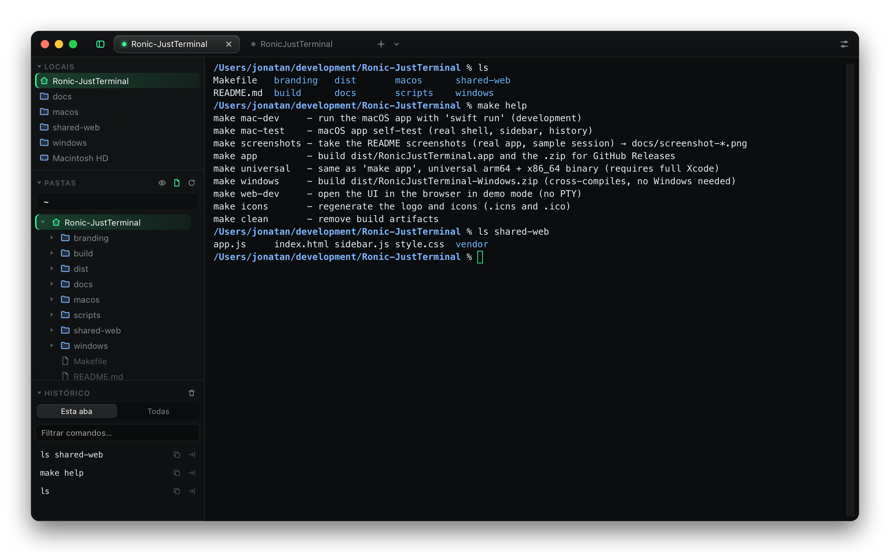
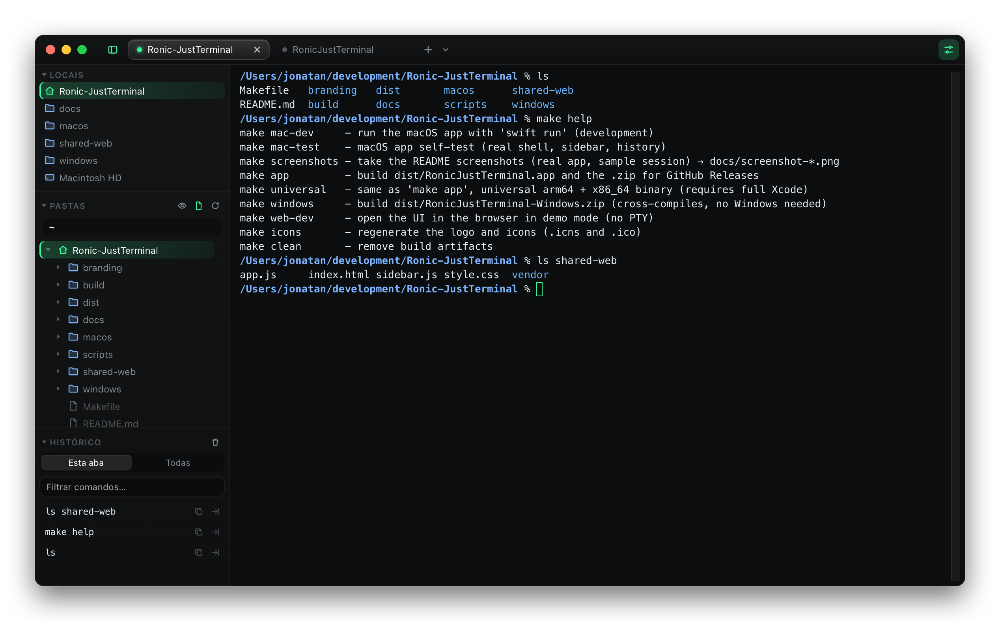
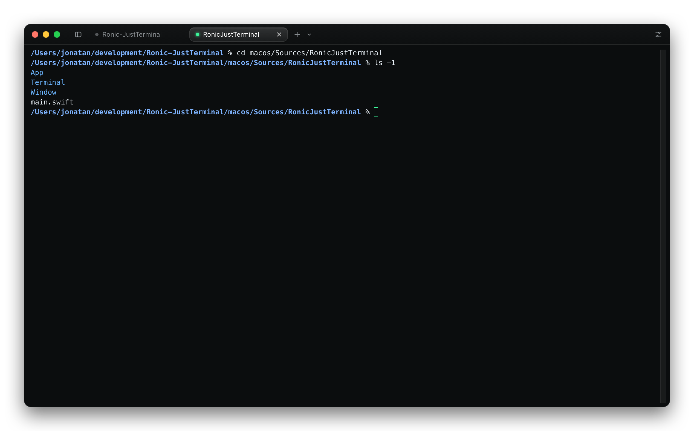

<p align="center">
  
</p>

<h1 align="center">Ronic JustTerminal</h1>

<p align="center">
  <b>A fast, minimal terminal with tabs, a folder sidebar and per-tab command history.</b><br>
  Glass look with adjustable opacity · keeps running when you close the window · macOS and Windows
</p>

<p align="center">
  <a href="https://github.com/jhowmael/Ronic-JustTerminal/releases/latest/download/RonicJustTerminal-macOS.zip">
    
  </a>
  &nbsp;
  <a href="https://github.com/jhowmael/Ronic-JustTerminal/releases/latest/download/RonicJustTerminal-Windows.zip">
    
  </a>
</p>

<p align="center">
  <a href="https://github.com/jhowmael/Ronic-JustTerminal/releases">All releases</a> ·
  <a href="#installation">Installation</a> ·
  <a href="#keyboard-shortcuts">Shortcuts</a> ·
  <a href="#build-and-test-locally">Build locally</a> ·
  <a href="docs/BRIDGE.md">Architecture</a>
</p>

<p align="center">
  
</p>

---

## Downloads

| System | File | Requirements |
|---|---|---|
| **macOS** (Apple Silicon and Intel) | [`RonicJustTerminal-macOS.zip`](https://github.com/jhowmael/Ronic-JustTerminal/releases/latest/download/RonicJustTerminal-macOS.zip) | macOS 13 Ventura or later |
| **Windows** (64-bit) | [`RonicJustTerminal-Windows.zip`](https://github.com/jhowmael/Ronic-JustTerminal/releases/latest/download/RonicJustTerminal-Windows.zip) | Windows 10 (1809+) or Windows 11 |

## Features

* **Independent tabs.** Every tab runs its own shell session. Open, switch, rename (double-click), reorder (drag) and close them. A yellow dot tells you when a background tab has new output.
* **Folder sidebar that follows the terminal.** Run `cd development` and the tree, the path bar and **Places** update right away. It also works the other way around: click a folder and the `cd` is typed for you. Right-click a folder to open a new tab there, copy or insert its path, reveal it in Finder/File Explorer or pin it to Places. Double-click a file to insert its path into the terminal.
* **Per-tab command history.** Every command you type shows up in the sidebar under **This tab** (*Esta aba*), with a search box. **All** (*Todas*) merges every tab and keeps the history across launches. Each entry has two buttons: **Copy** and **Insert into terminal**. Insert types the command without running it, so you can review it before pressing Enter.
* **Full-path prompt.** On macOS, the prompt shows where you are, like Windows does (`/Users/you/development %` instead of `Mac-mini:development you$`). It only replaces the system default prompt; custom prompts (oh-my-zsh, starship, your own `PS1`) are left alone. It never edits your shell files and can be turned off in Settings.
* **Glass with adjustable opacity.** The window starts fully dark (100% opacity). Lower the opacity in Settings to let the glass show through: Liquid Glass on macOS 26, Acrylic on Windows 11. Your choice is saved and restored on the next launch.
* **Keeps running in the background.** Closing the window does **not** end your shells. On macOS, the **R_** icon in the menu bar reopens the window, opens a new tab with any shell, or quits for good. On Windows, the same actions live in the system tray icon.
* **Fast.** The xterm.js renderer uses WebGL, PTY reads run on their own thread, and flow control keeps `cat huge-file` from freezing the window. The UI is plain HTML, CSS and JavaScript, with no framework.
* **Shells.** On macOS: your login shell (zsh/bash), plus bash, fish and nushell when installed. On Windows: PowerShell 7, Windows PowerShell, Command Prompt, WSL and Git Bash.

<p align="center">
  
  &nbsp;
  
</p>

> The app's UI is in Portuguese (Brazil): *Ajustes* = Settings, *Pastas* = Folders, *Locais* = Places, *Histórico* = History.

## Installation

### macOS

1. Download and unzip `RonicJustTerminal-macOS.zip`. Drag **RonicJustTerminal.app** into **Applications**. It shows up in Spotlight and Launchpad as **Ronic JustTerminal**, next to the other Ronic apps.
2. Open the app. The first time, macOS may block it: go to **System Settings › Privacy & Security** and click **Open Anyway**. From Terminal instead: `xattr -dr com.apple.quarantine /Applications/RonicJustTerminal.app`.
3. The first time a command touches Documents, Desktop or Downloads, macOS asks for permission once, as it does for any terminal.

### Windows

1. Download and unzip `RonicJustTerminal-Windows.zip` anywhere, for example `C:\Ronic JustTerminal`. Keep the `web`, `x64` and `arm64` folders and the `.dll` files next to the `.exe`.
2. Run **RonicJustTerminal.exe**. If SmartScreen warns you, click **More info › Run anyway**.
3. It uses the **Microsoft Edge WebView2 Runtime**, which ships with Windows 11 and up-to-date Windows 10. If it is missing, the app shows the download link.

## Keyboard shortcuts

| Action | macOS | Windows |
|---|---|---|
| New tab | ⌘T | Ctrl+Shift+T |
| Close tab | ⌘W | Ctrl+Shift+W |
| Next / previous tab | ⇧⌘] / ⇧⌘[ or ⌃Tab | Ctrl+Tab / Ctrl+Shift+Tab |
| Go to tab 1…9 | ⌘1…⌘9 | Ctrl+Alt+1…9 |
| Rename tab | ⇧⌘R or double-click | Ctrl+Shift+R or double-click |
| Sidebar (folders and history) | ⌃⌘S | Ctrl+Shift+B |
| Copy / paste | ⌘C / ⌘V | Ctrl+Shift+C (or Ctrl+C with a selection) / Ctrl+V |
| Clear | ⌘K | — |
| Bigger / smaller / default font | ⌘= / ⌘- / ⌘0 | Ctrl+= / Ctrl+- / Ctrl+0 |
| Settings | ⌘, | Ctrl+, |
| Close the window (keeps running) | ⇧⌘W or the red button | the X button |
| Quit for real | ⌘Q or **Quit** in the menu bar | **Exit** in the tray |

Links in the terminal open with ⌘-click (macOS) or Ctrl-click (Windows).

## Project structure

```
Ronic-JustTerminal/
├── shared-web/              Shared UI (macOS and Windows)
│   ├── index.html           Tab bar, sidebar, settings panel
│   ├── style.css            Glass look, dark theme
│   ├── app.js               Tabs, xterm.js, shortcuts, command history, bridge to the native app
│   ├── sidebar.js           Folder tree, Places, path bar, history list
│   └── vendor/              xterm.js 6 + addons (WebGL, fit, links, unicode), no CDN
├── macos/                   Native macOS app (Swift, AppKit + WKWebView)
│   ├── Package.swift
│   ├── Resources/           Info.plist, AppIcon.icns
│   └── Sources/RonicJustTerminal/
│       ├── App/             AppDelegate, main menu, menu bar icon, settings, self-test
│       ├── Window/          Window with glass (NSGlassEffectView / NSVisualEffectView)
│       └── Terminal/        PTYSession (forkpty), TerminalBridge, shell profiles, prompt integration
├── windows/                 Native Windows app (C#, .NET 10, WinForms + WebView2)
│   └── RonicJustTerminal/   MainForm (tray), ConPtySession (ConPTY), TerminalBridge…
├── branding/                Logo (generated in code) and icon script
├── scripts/                 macOS/Windows packaging, local signing, screenshots, xterm.js update
├── docs/BRIDGE.md           UI ↔ native contract, current directory, history, flow control
└── .github/workflows/       Release: builds macOS and Windows and publishes the .zip files
```

The **UI and tab management** live in `shared-web/` and are the same on both platforms. The **PTY layer** is native and separate: `PTYSession.swift` uses `forkpty` with zsh/bash on macOS, and `ConPtySession.cs` uses ConPTY with PowerShell, cmd or WSL on Windows. On Windows, the app ships the same up-to-date ConPTY that Windows Terminal uses (`conpty.dll` + `OpenConsole.exe`). The two layers talk through a JSON message contract ([`docs/BRIDGE.md`](docs/BRIDGE.md)).

## Build and test locally

### UI only (any OS, nothing to compile)

```bash
make web-dev          # opens shared-web/index.html in the browser
```

The page runs in **demo mode**, with a local echo and a fake folder tree where `cd` works. Use it to work on the look, the tabs and the sidebar.

### macOS

Requires **Xcode** or the Command Line Tools (`xcode-select --install`).

```bash
make mac-dev          # build and run the app (swift run), loading shared-web/ straight from the repo
make mac-test         # self-test: real shell, cd, sidebar, history, 2 tabs → build/selftest/*.json
make screenshots      # regenerate the README screenshots from the real app → docs/screenshot-*.png
make app              # build dist/RonicJustTerminal.app and dist/RonicJustTerminal-macOS.zip
open dist/RonicJustTerminal.app
```

* `JT_DEVTOOLS=1 make mac-dev` enables the Web Inspector (right-click › Inspect Element).
* On your machine, `make app` signs with a stable local certificate (`scripts/dev-signing.sh`), so folder permissions survive rebuilds.
* The self-test and screenshot modes use their own data folder (`JT_DATA_DIR`), so they never touch your settings or your shell history.

### Windows

Requires the **.NET 10 SDK**. The package can be built on a Mac or on Linux:

```bash
make windows          # builds dist/RonicJustTerminal-Windows.zip
```

On Windows, for development: `cd windows\RonicJustTerminal && dotnet run`. Details in [`windows/README.md`](windows/README.md).

### Manual test checklist

1. Open several tabs (⌘T / Ctrl+Shift+T), rename one with a double-click and drag it to reorder.
2. Run `cd ~/Downloads`: the sidebar tree and the path bar should follow. Click another folder in the sidebar: the `cd` shows up in the terminal.
3. Run a few commands in two different tabs and check that **History › This tab** only shows that tab's commands. Try **Copy** and **Insert**.
4. In **Settings**, lower the opacity to ~60%, quit the app (⌘Q) and open it again: the opacity must be the same.
5. Close the window (red button / X): the shells keep running. Reopen it from the menu bar or tray icon.
6. Run `yes` or `cat` a big file: the window stays responsive, and Ctrl+C stops it immediately.

## Publishing a release

```bash
git tag v0.3.0 && git push origin v0.3.0
```

The [`release.yml`](.github/workflows/release.yml) workflow builds the macOS app (universal) and the Windows app (x64) and publishes `RonicJustTerminal-macOS.zip` and `RonicJustTerminal-Windows.zip` to GitHub Releases. The download buttons at the top of this README always point to the latest release.

## Logo

The logo is a white **R** on a black background, with green characters raining down behind it like terminal output, plus a blinking cursor. It shares its geometry with the rest of the Ronic family (Ronic Mirror and Ronic MacToWindows). It is generated in code by [`branding/make-icons.swift`](branding/make-icons.swift). Run `make icons` to regenerate the PNGs, the `.icns` and the `.ico`.

---

Part of the **Ronic** family: [Ronic Mirror](https://github.com/jhowmael/Ronic-Mirror) · [Ronic MacToWindows](https://github.com/jhowmael/Ronic-MacToWindows)
